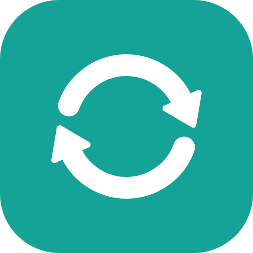

<p align="center">
  
</p>

<h1 align="center">KUDUSYNC</h1>

<p align="center">Keep folders in step on Windows: backups, mirrors and two-way sync between folders, drives, USB drives and network shares. A replacement for Microsoft SyncToy.</p>

<p align="center">
  <a href="https://github.com/azeembukhariprivate/kudusync/releases/latest/download/KUDUSYNC-setup.exe"></a>
  <br>
  <sub>The installer for Windows 10 and 11, always the latest version · <a href="https://github.com/azeembukhariprivate/kudusync/releases/latest">portable zip and what's new</a></sub>
</p>

---

## Features

- **Folder pairs**: two folders kept in step, each anywhere: a folder on this PC, a whole drive, a USB drive or memory card, or a network share (`\\server\share`), in any combination.
- **Four ways to keep them in step**:
  - **Mirror**: the destination becomes an exact copy of the source (SyncToy's *Echo*).
  - **Update**: new and changed files are copied to the destination; nothing is ever deleted there (SyncToy's *Contribute*).
  - **Two-way sync**: changes on either side are copied to the other, deletions included (SyncToy's *Synchronize*). If the same file changed on both sides, **both are kept**: the newer one keeps the name and the other is saved next to it as `name (conflict 2026-10-24).ext`, on both sides.
  - **Move**: files are copied to the destination, then removed from the source (emptying a camera card or a Downloads folder). Folders it empties are tidied away.
- **Preview** what a sync will do before it does it, and untick anything you don't want done this time.
- **Nothing is lost by mistake**: files a sync replaces or deletes go to a hidden `_KUDUSYNC History` folder on that drive (or a folder you choose) and are cleaned up after 7, 30, 90 or 365 days, or kept forever.
- **Safety checks**: a sync that would empty a folder completely (for example because the source drive is blank or not working) always waits for you, and scheduled syncs that would delete more than half of the files are paused too. A folder that can't be read is left alone on both sides, and a two-way pair whose folder has gone missing won't treat everything in it as deleted.
- **Renamed and moved files are renamed**, not copied again (exact on NTFS, using the file's ID; elsewhere by size and time, only when there's exactly one match).
- **USB drives are recognised by the drive itself**, not by its letter: a pair keeps working when Windows gives the drive another letter, and never syncs into a different drive that got the old letter.
- **Network shares** that need a login: it's saved in Windows Credential Manager (never by KUDUSYNC itself) and used for scheduled syncs too. A share that's asleep is retried before giving up.
- **Schedules** (every day, certain days, every few hours, or when you sign in) are Windows Task Scheduler tasks, so they run even when KUDUSYNC is closed, without administrator rights, and missed runs happen as soon as the PC is back on. They run while you're signed in to Windows (a locked screen is fine); a run missed while you were signed out happens when you sign in again.
- **In the notification area** (optional): **live sync** keeps a pair in step a short while after files change, and a **notification when a pair's USB drive is plugged in** lets you sync it with one click.
- **Right-click a folder** in File Explorer: *Sync with KUDUSYNC* runs the pairs that use it; *Back up this folder with KUDUSYNC…* creates a new pair (optional, chosen when installing or in Settings).
- **Import from SyncToy**: SyncToy 2.x's folder pairs are read straight from its settings and brought across, with their filters and "Check file contents".
- **Compare file contents** (optional, per pair): files with the same size and date are also compared byte by byte, to catch changes those don't show. Slower, since the files are read on both sides.
- **Filters**: include and leave out files by name pattern, leave out folders, skip hidden and system files. Office lock files (`~$*`), `*.tmp` and `Thumbs.db` are left out by default.
- **Careful copying**: copies are written to a temporary file and only get their real name when complete; files that change while being copied are tried again next time; files in use are skipped and retried; dates and attributes are kept; paths longer than 260 characters work; optional **checking of every copy** against the original.
- **History of every run** (from the window, a schedule, live sync or a notification) with a full text log, plus Windows notifications for scheduled and automatic syncs.
- Light and dark themes, following Windows.

## How it works

Each pair keeps a small record of what both folders looked like after its last sync. It's kept on this PC only (in `%LOCALAPPDATA%\KUDUSYNC`), so nothing is written into your folders except the `_KUDUSYNC History` folder. Two-way sync needs the record to tell a file that's new on one side from one that was deleted on the other; all modes use it to recognise renamed files. If the record is lost, the next run is treated as a first run, which never deletes anything.

Files are compared by size and modified time (allowing for the 2-second precision of FAT drives). FAT and exFAT drives (most USB sticks and memory cards) store local time, so when the clocks change every file's time moves by exactly an hour; on those drives a one-hour difference counts as the same, so nothing is copied again.

## Download

**[Download the installer](https://github.com/azeembukhariprivate/kudusync/releases/latest/download/KUDUSYNC-setup.exe)** (`KUDUSYNC-setup.exe`, always the latest version), or get any of these from the [Releases page](https://github.com/azeembukhariprivate/kudusync/releases/latest):

- `KUDUSYNC-x.y.z-setup.exe` installs KUDUSYNC for your Windows account (no administrator rights needed).
- `KUDUSYNC-x.y.z-portable.zip` runs without installing: unzip it anywhere and open `KUDUSYNC.exe`. The portable copy keeps its pairs and logs in a `Data` folder beside it.

Requires Windows 10 or 11 (the .NET Framework 4.8 it uses is already part of Windows).

## Privacy

KUDUSYNC works entirely on your computer and your network. The only internet request it makes is an optional check for a newer version on GitHub, which can be turned off in Settings.

## Build from source

You need the [.NET SDK](https://dotnet.microsoft.com/download) (8 or later). The screens are built in C# and the themes are loaded at startup, so the project builds with `dotnet` on any operating system; the app itself runs on Windows.

```
dotnet run --project tests/KUDUSYNC.Tests
dotnet build src/KUDUSYNC/KUDUSYNC.csproj -c Release -o out/KUDUSYNC
out\KUDUSYNC\KUDUSYNC.exe --self-test
```

The tests plan every mode against made-up folder trees and run real syncs on temporary folders: mirror, update, move and two-way (first-run merge, changes, deletions, conflicts, a change beating a deletion), renames, filters, unreadable folders, safety checks, unticked steps, verification, history clean-up, the record, pairs and the run log, schedules and the SyncToy import. `--self-test` needs administrator rights: it syncs real folders in every mode and compares every byte, checks renames by NTFS file ID, a file in use, very long paths and attributes, creates a virtual USB drive (VHD) and changes its letter, syncs to a FAT32 drive and a network share, creates every kind of Windows Task Scheduler task and lets Windows run one, starts the tray part and checks live sync and the drive-plugged-in notification, checks the right-click menu and the SyncToy import, drives every screen in both themes, writes `self-test.log` and exits. To build the installer, install [Inno Setup 6](https://jrsoftware.org/isinfo.php) and compile `installer/KUDUSYNC.iss`.


### Shared code

Some files (the look, dialogs, the update check, administrator helpers) are shared by the KUDU apps and come from
[kudu-common](https://github.com/azeembukhariprivate/kudu-common); each starts with a comment saying so, and `.kudu-common`
lists them. You don't need kudu-common to build this app, but change those files there, not here: the build checks that
they match.

## Publishing a new version

1. Change `<Version>` in `src/KUDUSYNC/KUDUSYNC.csproj` (and `MyAppVersion` in `installer/KUDUSYNC.iss`).
2. Commit and push to `main`.
3. GitHub Actions tests and builds the app. When no release exists yet for that version, it creates the `v` tag and publishes the installer and portable zip on the Releases page. Pushes that keep the same version only build.

## License

[MIT](LICENSE). See [THIRD-PARTY-NOTICES.txt](THIRD-PARTY-NOTICES.txt).
